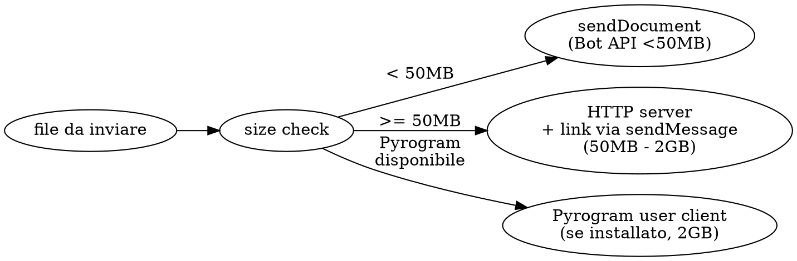

# Telegram File Send

Skill per consegnare file dal DGX Spark (o PC Windows con share Z:) al telefono
dell'utente (Giovanni, chat_id `407582054`, account `jagones84@gmail.com`)
via Telegram, scegliendo automaticamente il metodo migliore in base alla
dimensione. Pensata per il caso operativo "utente dice: mandami questo file
sul telefono".

> Source of truth: `~/.openclaw/workspace/skills/telegram-file-send/`
> su DGX, equivalente a `Z:\.openclaw\workspace\skills\telegram-file-send\`
> su Windows (stessa home condivisa via sshfs).

## Identita e componenti

| Componente       | Valore                                                          |
|------------------|-----------------------------------------------------------------|
| Utente Telegram  | `407582054` (Giovanni, "jagones")                              |
| Bot predefinito  | `@Jagones_Bot` (7737497525:AAEk\_ZUy1Q8gFbMNvsgOQlt4Hwe2-M6mNog)|
| Limite Bot API   | **50 MB** per file (cloud api.telegram.org)                     |
| Limite user      | **2 GB** (serve Pyrogram o local Bot API server)                |
| Token sorgente   | `~/.openclaw/gateway.systemd.env` (`TELEGRAM_BOT_TOKEN`)        |
| HTTP serve root  | path passato come argomento (default cwd)                       |

## Strategia di selezione automatica



Default flow (no Pyrogram configurato):

| Dimensione file       | Metodo                                  | Click utente richiesto |
|-----------------------|-----------------------------------------|------------------------|
| < 50 MB               | `sendDocument` come allegato            | 0 (notifica push)      |
| 50 MB - 2 GB          | HTTP server bound 0.0.0.0 + link        | 1 (toccare il link)    |

Per i file > 2 GB: spezzare in chunk < 2 GB (vedi Sezione "Gotchas").

## Procedura operativa

### Caso A - file < 50 MB (allegato diretto)

```bash
python3 ~/.openclaw/workspace/skills/telegram-file-send/scripts/tg_send.py send \
  --file /percorso/al/file.pdf \
  --caption "ecco il file"
```

Lo script:
1. Verifica che il file esista e sia < 50 MB.
2. Carica `TELEGRAM_BOT_TOKEN` da `~/.openclaw/gateway.systemd.env`
   (o da `--token` esplicito).
3. Chiama `POST https://api.telegram.org/bot<token>/sendDocument`
   con multipart upload del file a `chat_id=407582054`.
4. Stampa `message_id` e `file_id` ricevuti.

### Caso B - file 50 MB - 2 GB (link via HTTP server)

Sequenza comandi (eseguire dal PC Windows per sfruttare il binding
Tailscale 100.76.251.9:8000 + LAN 192.168.1.11:8000, oppure dal DGX
per binding diretto):

```bash
# 1. avvia http server background bound 0.0.0.0:8000, root <DIR>
python3 ~/.openclaw/workspace/skills/telegram-file-send/scripts/tg_http_serve.py \
  --port 8000 --root <DIR> --background

# 2. invia link via sendMessage (URL LAN + Tailscale)
python3 ~/.openclaw/workspace/skills/telegram-file-send/scripts/tg_send.py link \
  --file-relative <PATH_RELATIVO_A_ROOT> \
  --text-prefix "Pronto per il download."

# 3. (quando l'utente conferma) ferma http server
python3 ~/.openclaw/workspace/skills/telegram-file-send/scripts/tg_http_serve.py stop
```

Lo script `tg_send.py link` produce 2 URL (LAN + Tailscale), li invia
all'utente come messaggio formattato. L'utente tocca il link dal
browser del telefono e il download parte.

### Caso C - invio messaggio solo testo

```bash
python3 ~/.openclaw/workspace/skills/telegram-file-send/scripts/tg_send.py text \
  --text "messaggio di test"
```

Utile per ping, svegliare la chat, o test connectivity.

## Prerequisiti

- Python 3.11+ con `requests` (gia' installato sul DGX).
- Bot token di Raffaella in `~/.openclaw/gateway.systemd.env`
  (gia' configurato). Variabile env: `TELEGRAM_BOT_TOKEN`.
- Tailscale attivo su entrambi i lati per il Caso B (verificare
  con `tailscale status`).
- HTTP server Caso B: il telefono deve poter raggiungere PC/DGX via
  IP Tailscale o LAN. Su OnePlus 15R, se WiFi di casa attivo, anche
  l'IP LAN funziona (piu' veloce).

## Regole d'oro / Gotchas

1. **Bot API limite 50 MB.** `sendDocument` fallira' con
   `Request Entity Too Large` per file > 50 MB. Controllare la size
   PRIMA di chiamare l'API (lo script `tg_send.py send` lo fa).
2. **CRLF nei file script.** Quando si creano script PowerShell o
   bash da uploadare al DGX, controllare `file <script>` non riporti
   "CRLF". Un heredoc PowerShell mette CRLF e lo script Python muore
   con `import error`. Fix: `sed -i 's/\r$//' <file>` post-upload.
3. **HTTP server Caso B: firewall Windows.** Tailscale e' classificato
   come rete Private, di solito il default inbound su Private e' Allow,
   quindi il firewall NON blocca la 8000 in ingresso. Verificare con
   `Get-NetConnectionProfile | ? InterfaceAlias -like '*tailscale*'`.
4. **HTTP server Caso B: porta occupata.** Prima di lanciare
   `tg_http_serve.py`, controllare che la porta sia libera
   (`Get-NetTCPConnection -LocalPort 8000 -State Listen`).
5. **OnePlus OxygenOS 16 deep sleep.** Se il telefono e' in tasca da
   >5 minuti, Tailscale va in deep sleep. Workaround: aprire l'app
   Tailscale sul telefono per svegliarlo (5 sec). Senza Tailscale
   attivo, il download via link Tailscale non parte.
6. **Notifiche push silenziate.** Se l'utente ha silenziato la chat
   con `@Jagones_Bot`, il messaggio arriva ma nessuna notifica.
   Workaround: mandare 2-3 messaggi ravvicinati (`text` + `link`) o
   ricordare all'utente di aprire Telegram sul telefono.
7. **Path con spazi.** Lo script gestisce path con spazi tramite
   `os.path` e `shlex.quote` per il curl di fallback (se manca
   `requests`). Mai passare path non quotati in shell.
8. **File molto grossi (> 2 GB): split.** Il Bot API non supporta
   >50 MB e user client ha tetto 2 GB. Per file piu' grossi:
   `split -b 1900m bigfile.mov chunk_` e inviare ogni chunk via
   Pyrogram o via link. L'utente riassembla con `cat chunk_* > bigfile.mov`.
9. **Compressione opzionale.** Per ridurre la dimensione prima di
   `sendDocument`: `ffmpeg -i input.mp4 -vf scale=640:-2 -b:v 600k
   -c:a aac -b:a 96k output.mp4`. Perdo qualita' ma sta sotto i
   50MB. Da usare SOLO se l'utente accetta il tradeoff.
10. **Mai loggare il bot token.** Lo script lo legge da env e lo
    maschera nei log. Non scriverlo mai in file di config committati.

## File (scripts/)

| File                    | Cosa fa                                                            |
|-------------------------|--------------------------------------------------------------------|
| `tg_send.py`            | CLI principale con sub-comandi `send`, `link`, `text`             |
| `tg_http_serve.py`      | HTTP server background bound 0.0.0.0 con PID file + stop pulito    |
| `check_env.sh`          | Verifica python/requests/curl/jq + token bot caricato              |
| `lib_tg.py`             | Helper condivisi (load token, post multipart, errors)              |

## Verifica veloce

```bash
# 1. ambiente
bash ~/.openclaw/workspace/skills/telegram-file-send/scripts/check_env.sh

# 2. ping (solo testo, dovrebbe arrivare notifica push al telefono)
python3 ~/.openclaw/workspace/skills/telegram-file-send/scripts/tg_send.py text \
  --text "test tg-send $(date +%H:%M:%S)"

# 3. upload file piccolo
python3 ~/.openclaw/workspace/skills/telegram-file-send/scripts/tg_send.py send \
  --file /etc/hostname --caption "test send document"

# 4. (se e2e fallisce) verifica allowlist
ssh dgx "/home/jagones/.nvm/versions/node/v24.15.0/bin/node \
  /home/jagones/.local/bin/openclaw skills show telegram-file-send"
# atteso: | ready | telegram-file-send | ... | openclaw-managed |
```

## Cosa NON fa

- **Non invia a chat di gruppo.** Lavora solo sul DM 407582054. Per
  gruppi serve `chat_id` del gruppo e `--chat` esplicito.
- **Non installa Pyrogram.** Il supporto Pyrogram e' documentato ma
  richiede setup interattivo (OTP telefono). Da fare in sessione
  separata con coinvolgimento utente.
- **Non gestisce upload paralleli.** Un comando = un file. Per batch
  parallelo, lanciare piu' istanze (ma attenzione al rate limit
  Telegram: 30 msg/sec globale, 1 msg/sec per chat).
- **Non fornisce progress bar.** Telegram API non supporta progress
  durante upload. Lo script aspetta il 200 e poi stampa OK.
